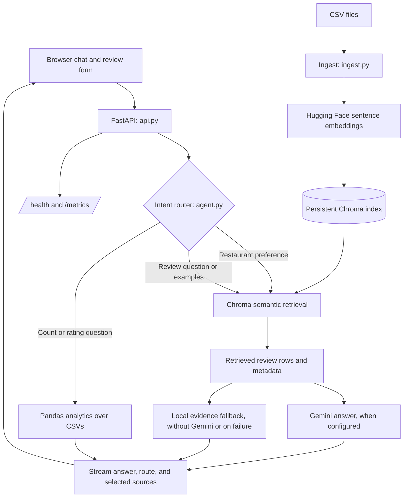
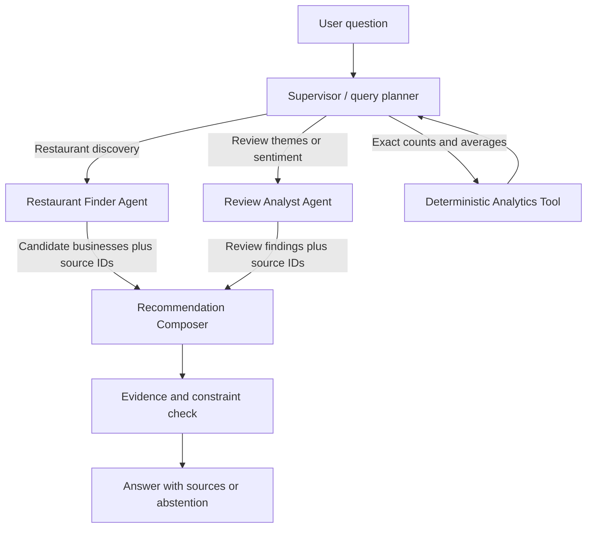

# Restaurant Review Agent — Viva Prep

## 30-second introduction

“This project is a restaurant discovery and review assistant built with retrieval-augmented generation. It searches an included Yelp dataset and a smaller pizza review dataset. A user can ask for restaurants by cuisine and city, explore what reviewers say, request review examples, and get exact rating statistics. FastAPI serves the app, Chroma stores searchable review embeddings, and Gemini can summarize retrieved evidence. The current version is one tool-routed agent; I’ll describe a multi-agent extension as future work.”

## What problem does it solve?

Restaurant customers and analysts can have many reviews to scan. This app searches the review data and returns a small, relevant set of businesses or review evidence. It also calculates rating counts and averages directly from the CSV data.

The Yelp file contains **14,351 review rows for 2,526 distinct businesses**, across **371 city/state pairs**. The current index contains **14,478 rows** across Yelp and the included pizza review data. Yelp review dates span **2005–2018**, so the app cannot confirm current ratings, opening hours, availability, or whether a business is still operating.

## Architecture

### Main components

- **`static/index.html`** provides the chat, review form, health card, request metrics, and source-review table.
- **`api.py`** starts FastAPI, validates requests with Pydantic, streams chat events using server-sent events, saves submitted reviews, and exposes `/health` and `/metrics`.
- **`ingest.py`** reads CSV rows, turns each row into a LangChain document, preserves columns as metadata, embeds the documents, and stores them in Chroma. A hash manifest identifies changed or removed CSV files so only affected rows need reindexing. Chroma’s maximum batch size is respected during ingestion.
- **`retrieval.py`** builds the Chroma retriever, configured to return up to 60 candidate rows for a query.
- **`agent.py`** applies small, deterministic intent rules for restaurant search, review examples, capabilities, and analytics. It applies exact rating filters and filters retrieved recommendation candidates to a city when the query explicitly names one.
- **`chat.py`** defines the Gemini prompt and streaming answer, selects diverse business evidence, and provides local fallbacks when Gemini is not configured or fails.
- **`csv_data.py`** validates and safely writes submitted review rows to the backend-managed CSV.
- **`config.py`** keeps model names, storage paths, and retrieval limits in one place. API keys are loaded from `.env`, which is excluded from Git.

## How the system works

### 1. Indexing the data

At startup, FastAPI calls `build_store()`. The ingester reads the project CSV files and managed upload CSVs. Each row becomes one document containing the row fields, such as review text, restaurant name, categories, city, state, and business rating. The embedding model **BAAI/bge-small-en-v1.5** converts the document text into a vector, and Chroma persists the vectors and metadata under `chroma_db/`.

The manifest records each CSV’s SHA-256 hash and the embedding model name. If a file changes, the existing documents for that file are removed and its rows are embedded again. New rows use stable file-and-row IDs. Large files are sent to Chroma in supported batches.

### 2. Handling a question

1. The browser sends a question to `POST /chat`.
2. FastAPI trims and validates it, with a maximum length of 1,000 characters.
3. The router identifies the request type. For example, an average-rating question uses Pandas; a restaurant preference question uses semantic retrieval.
4. For retrieval, Chroma returns relevant rows. When a city appears in the question and in the candidate metadata, recommendations are filtered to that city. Duplicate reviews from the same business are reduced before showing recommendations.
5. If Gemini is configured, the app streams a response based on retrieved rows. If Gemini is unavailable, the app can still show the matching restaurant details or create a small local review summary.
6. The response is streamed to the browser. Recommendation and explicit example requests include source rows in the UI.

### 3. Handling submitted reviews

The form submits structured fields to `POST /reviews`. Pydantic checks title, rating, date, and review length. `csv_data.py` writes to the managed CSV, then the index is rebuilt or refreshed. The CSV is stored on the backend and is not displayed as a downloadable file in the UI.

## What features are implemented?

- Search restaurant reviews by natural-language topic.
- Find restaurants by cuisine and location using retrieved Yelp review evidence.
- Return business name, city/state, categories, business rating, and review count when those fields exist in the source row.
- Filter an explicit star-rating request and show selected review examples. The filter currently targets the `Rating` field; Yelp stores that value as `stars_review`, so consistent star filtering across both sources still needs schema normalization.
- Calculate rating averages, counts, and distinct Yelp business counts deterministically with Pandas.
- Accept validated review submissions and update search indexing.
- Stream responses and expose basic service health and request/latency metrics.
- Run locally; a Dockerfile is included for packaging.

## Current design: single agent with tools

**Is this a multi-agent system?**

“No. It is one assistant with deterministic routing to capabilities: restaurant search, review search, and rating analytics. The LLM does not choose freely among many tools; the small router selects the path. That is easier to inspect and test for this project’s limited scope.”

**What makes it agentic?**

“It accepts a natural-language task and routes it to the relevant capability, such as retrieval or exact analytics, then combines the tool result into a response. It has bounded behavior rather than an open-ended autonomous loop.”

### Short demo sequence

1. **Restaurant search:** “Where should I go for great Indian food in Philadelphia?” Explain the `restaurant_search` route, semantic retrieval, city constraint, returned business metadata, and historical source evidence.
2. **Review themes:** “What do customers say about the crust?” Explain that the review text is retrieved before the answer is generated.
3. **Exact analytics:** “What is the average rating?” Explain that this takes the Pandas route and does not ask Gemini to calculate the average.
4. **Capabilities:** “What can you do?” Show the bounded scope of the assistant.

## How we could make it a multi-agent system

Use a **supervisor and specialist agents**. Keep the existing APIs, CSVs, Chroma index, metrics, and exact Pandas analytics. Add orchestration around the capabilities rather than duplicating the data pipeline.

### Specialist responsibilities

1. **Supervisor / query planner** extracts the user’s intent and explicit constraints, such as city, cuisine, and desired review theme. It decides which specialist is needed. It asks a clarifying question if a required constraint is ambiguous.
2. **Restaurant Finder Agent** uses Chroma to find candidate restaurants. It returns structured candidates, not a free-form answer: business name, city/state, categories, business rating, review count, and supporting row IDs.
3. **Review Analyst Agent** retrieves and summarizes supporting praise, complaints, or themes. It must include the row IDs behind each finding.
4. **Analytics capability** remains deterministic Pandas code for arithmetic. It does not need to be an LLM agent.
5. **Recommendation Composer** compares the candidate list with the user’s stated preferences and writes a concise answer with evidence and limitations.
6. **Evidence check** verifies that each recommendation exists in the retrieved candidate list, honors explicit city/cuisine constraints when possible, and has supporting rows. If evidence is missing, the system should say so.

### Example multi-agent flow

For “Find a well-rated Indian restaurant in Philadelphia and tell me what reviewers like about it,” the supervisor can run the finder and analyst in parallel. The finder returns matching businesses and ratings. The analyst retrieves positive review evidence about those businesses. The composer joins only candidates supported by both results, then returns short explanations and source rows. If the request is only “What is the average rating?”, the supervisor calls the analytics function directly and skips the LLM specialists.

### A practical implementation sequence

1. Define typed input/output schemas for the query plan, restaurant candidates, review findings, and final answer.
2. Extract the current retrieval and analytics operations behind callable tools without changing their behavior.
3. Add a supervisor graph with explicit routing and bounded parallel calls. A graph framework such as LangGraph is an option if it is already installed; otherwise a small explicit orchestration function is enough for a class demo.
4. Require each specialist to return evidence IDs. Keep the current deterministic city filter and exact analytics.
5. Add tests for routing, constraint handling, citations, missing evidence, and specialist failure. Compare the multi-agent result with the current single-agent baseline.
6. Trace each agent/tool call and measure end-to-end latency, errors, token usage/cost, retrieval quality, and whether the final answer respects the constraints.

Do not add agents just to increase the agent count. A multi-agent design is justified when subtasks can work independently or require distinct prompts and outputs. Otherwise, the current simpler router is cheaper and easier to debug.

## Monitoring and MLOps points

- **Health:** `GET /health` reports readiness, indexed document count, model names, whether Gemini is configured, and available routes.
- **Runtime metrics:** `GET /metrics` reports request count, error count, total/average latency, and last-request latency.
- **Data/index versioning:** the ingestion manifest stores source-file hashes and the embedding model name.
- **Evaluation:** seven automated tests cover recommendation city constraints, distinct businesses, review summaries, rating filters, analytics routing, capabilities, no-match behavior, and statistics. A live retrieval check also verified cuisine-and-city search against the 14,478-row index.
- **Reproducibility:** model names and retrieval limits live in configuration; dependencies are pinned in `requirements.txt`.
- **Secrets:** API keys belong in `.env`, never in source control. The project’s `.gitignore` excludes `.env`, uploads, the virtual environment, and generated Chroma files.

These are demo-level MLOps practices. Metrics are in memory and reset when the process restarts; they are not a durable monitoring service or alert system.

## Likely viva questions and answers

**Why use RAG instead of putting the whole CSV in the prompt?**  
“The dataset has over fourteen thousand Yelp reviews. Retrieval selects relevant rows for each question, keeping the prompt smaller and making it easier to ground the answer in specific evidence.”

**What does the embedding model do?**  
“It converts review text and a question into vectors. Chroma compares those vectors to find semantically related reviews, including cases where the wording differs.”

**Why use Chroma?**  
“It gives us persistent vector search and metadata filtering in a small local setup. Metadata lets the agent retain fields like business name, rating, and city alongside the review text.”

**Why use Pandas for rating questions?**  
“Averages and counts are exact calculations, so the application computes them directly instead of asking an LLM to do arithmetic.”

**How do you prevent unsupported answers?**  
“The prompt instructs Gemini to use only retrieved reviews, and the no-model fallback only reports retrieved evidence. If retrieval is empty, the answer says it could not find supporting reviews. We still need a larger evaluation set to measure grounding systematically.”

**Are the recommendations current?**  
“No. Yelp review dates span 2005 to 2018. The system can compare historical evidence, but cannot check current status, hours, availability, or ratings.”

**What happens when Gemini is unavailable?**  
“Restaurant search can show retrieved business details directly and analytics still works because it is deterministic. Review questions use a local keyword-and-rating summary; that fallback currently reads the `Rating` field, so it does not interpret Yelp’s `stars_review` field consistently yet.”

**What is monitored?**  
“The health endpoint reports readiness and index size. The metrics endpoint tracks requests, errors, and latency. These counters reset on restart, so production monitoring would need durable metrics, traces, dashboards, and alerts.”

**Is it deployed?**  
“It runs as a local FastAPI app, and a Dockerfile is included. It is not deployed as a hosted production service.”

**What would you improve first?**  
“I would improve the evaluation set and retrieval/answer grounding checks, then add durable monitoring and a secure hosted deployment. I would add specialist agents only when a workflow needs parallel or distinct reasoning.”

## Honest scope to state

- This is a working **single-agent, tool-routed** application, not a multi-agent system yet.
- Yelp evidence is historical and should not be presented as live business information.
- The model can only answer about the included datasets; it does not browse current menus, prices, hours, or business status.
- Yelp star ratings use a different source column from the pizza sample, so exact rating filters and the local sentiment fallback need a shared normalized rating field.
- Price and occasion are not structured business fields; the model can only match them when retrieved review text supports the preference.
- Health and request metrics are implemented, but durable monitoring and cloud deployment are future work.
- The review submission form creates generic review rows; it does not collect structured restaurant identity fields like the Yelp data does.
